# POS IMS Full Introduction and Documentation

## 1. Introduction

POS IMS is a unified retail operations and accounting system built on Django. It is designed to help a business run sales, purchasing, stock management, party balances, expenses, and accounting from one application instead of maintaining separate spreadsheets or disconnected tools.

The key design principle in this codebase is alignment between operations and finance:

- purchases update inventory and supplier balances
- sales update stock and accounting
- credit sales update customer receivables
- expenses post to expense accounts and liabilities when unpaid
- money desk operations explain where cash and bank balances came from

## Interface snapshots

### Dashboard

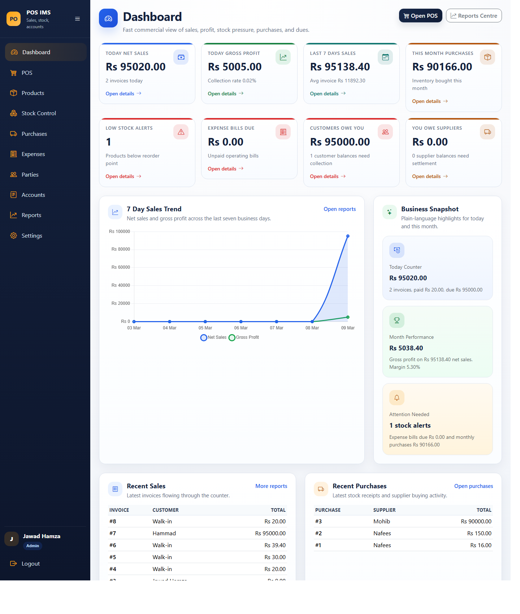

### POS checkout

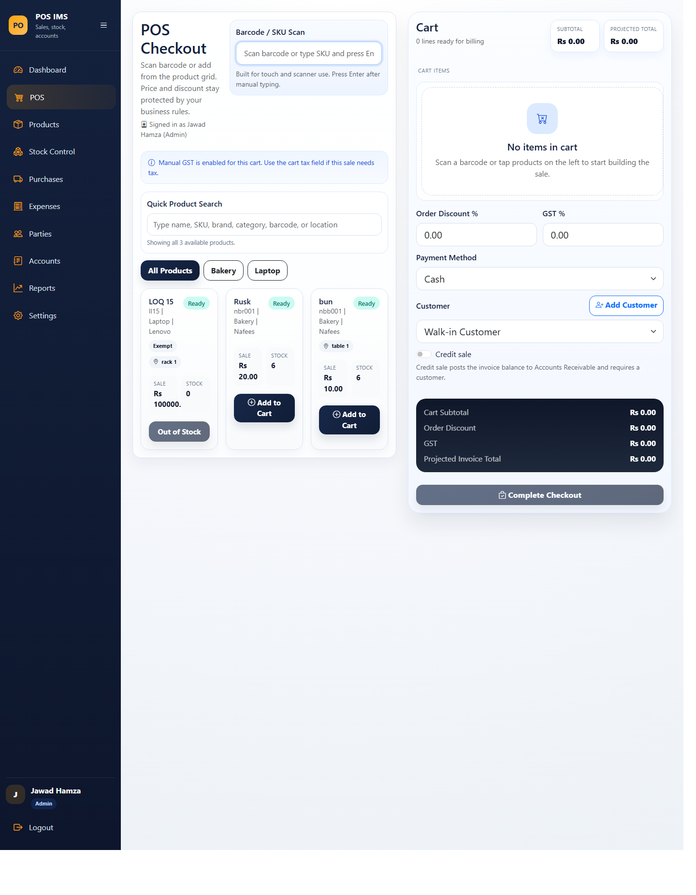

### Products

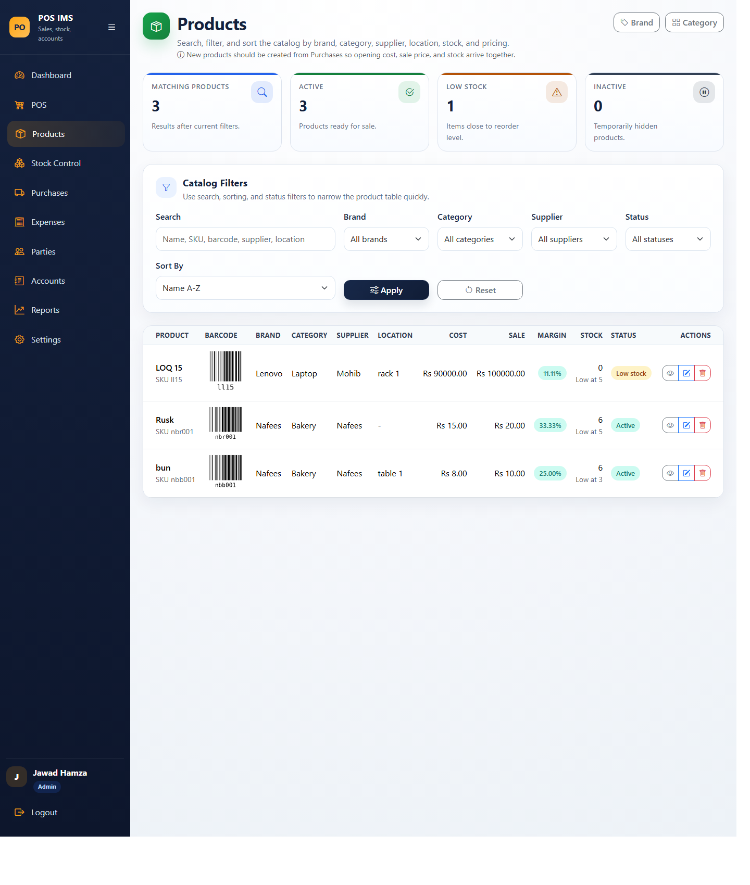

### Purchases

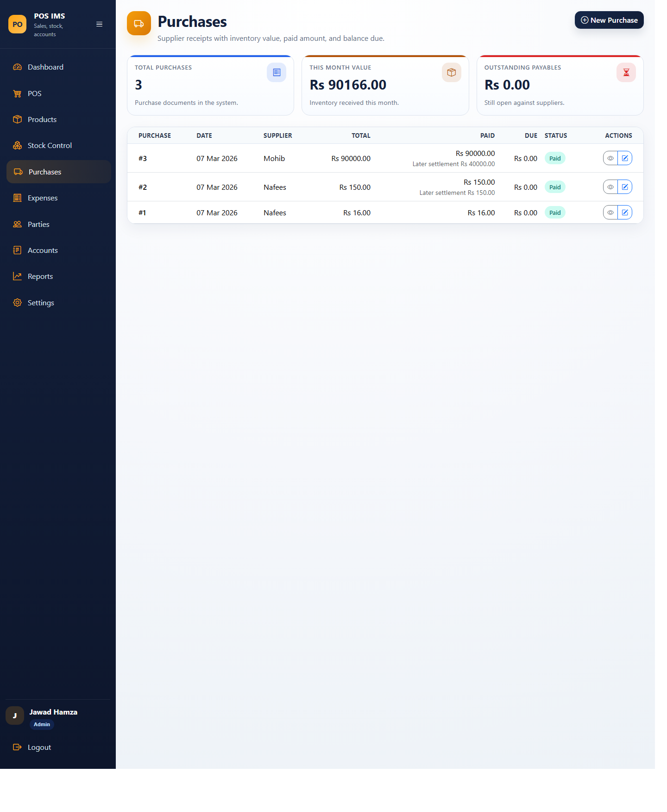

### Stock Control

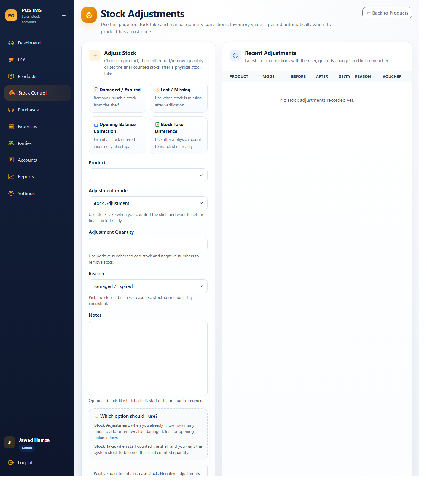

### Parties

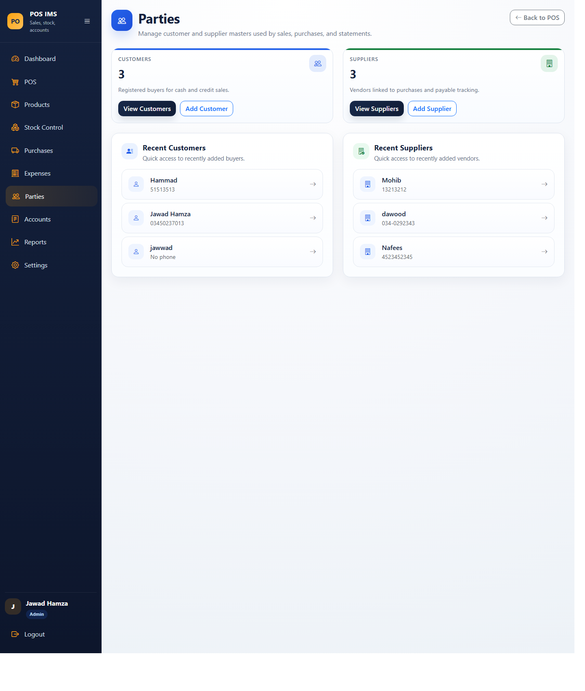

### Customers


### Suppliers

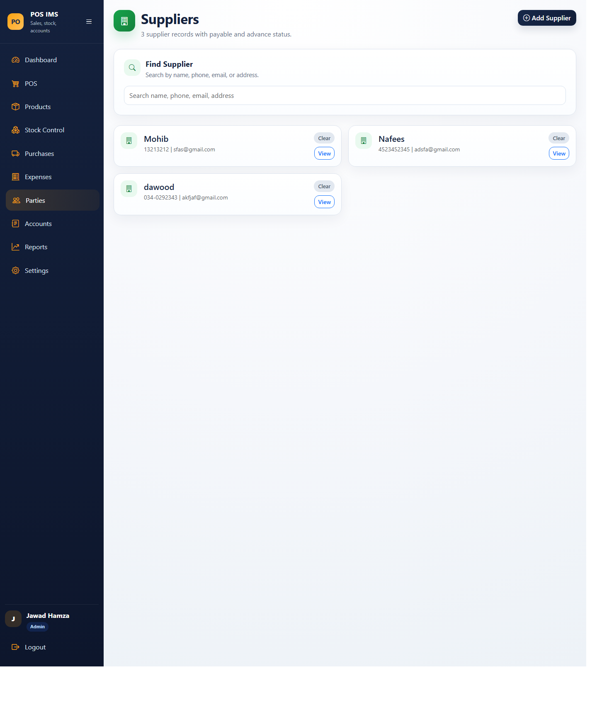

### Expenses

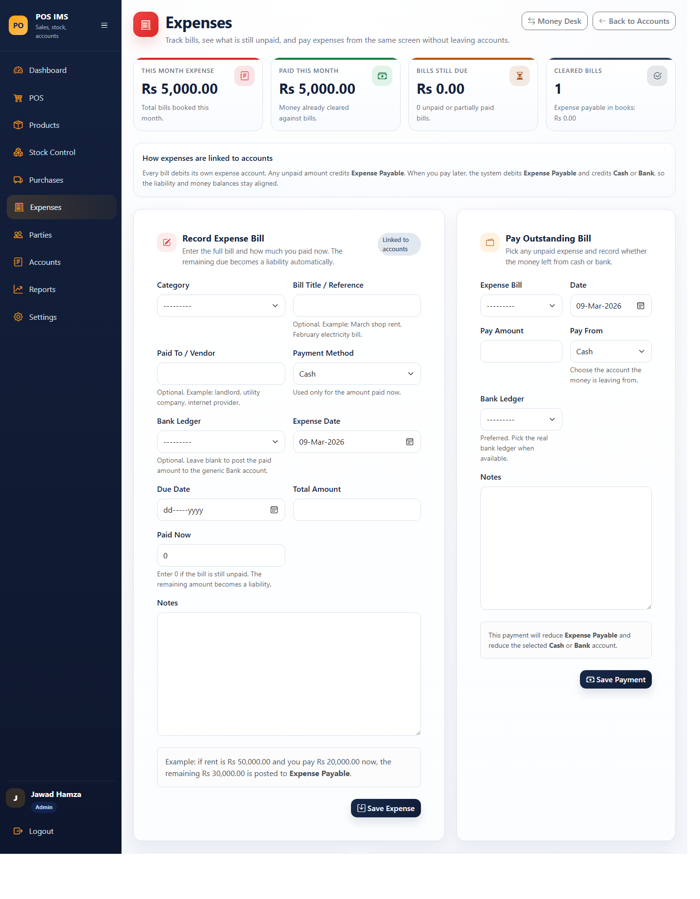

### Money Desk

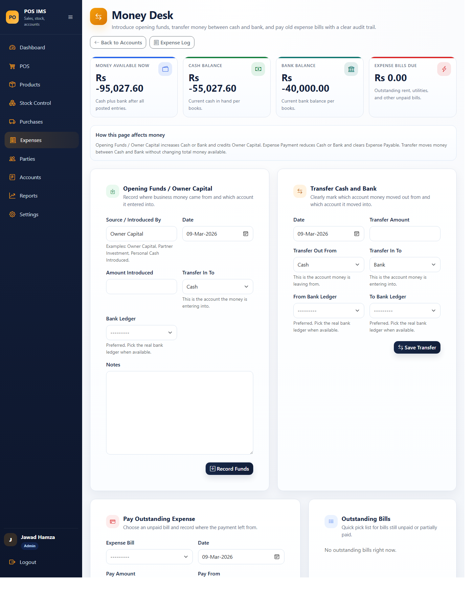

### Accounts

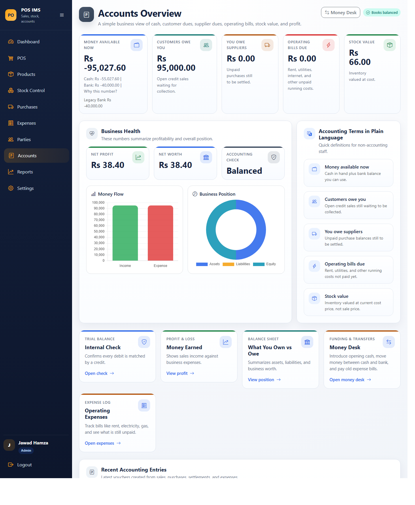

### Reports

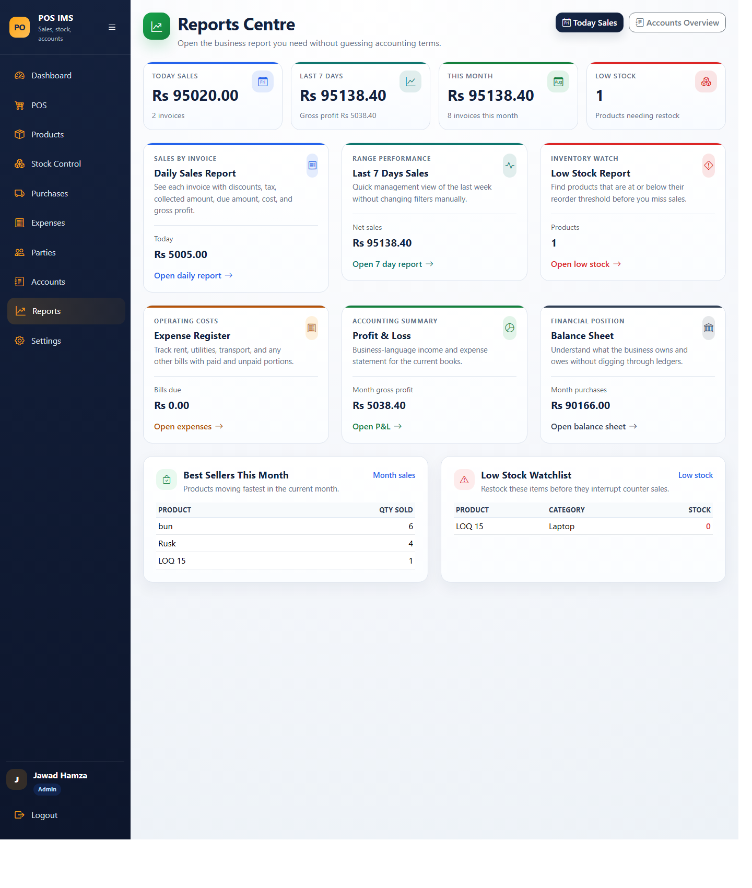

## 2. Technology profile

- Framework: Django
- Database in this repository: SQLite for local operation and development
- UI: Django templates with Bootstrap and Bootstrap Icons
- PDF capability: ReportLab is available in the project environment
- Authentication: Django auth with group-based roles

The virtual environment in this repository is configured with Python `3.14.3`.

## 3. Project apps and responsibility boundaries

### `pos`

Owns most operator-facing workflows:

- login and first-admin setup
- dashboard and reports
- POS checkout and receipt flow
- products, categories, brands, and suppliers
- purchases and purchase editing
- parties and their detail pages
- stock adjustments
- sale returns and purchase returns
- settings page and many admin tools

### `accounts`

Owns the accounting layer:

- chart of accounts
- bank ledgers
- vouchers and voucher lines
- accounting events and posting services
- settlements and party ledgers
- expenses and expense payments
- owner capital and money transfers
- audit log and backups
- financial statements and ledgers

### `api`

Owns UI-supporting API endpoints:

- party statement endpoint
- settlement endpoint

### `possumus`

Owns project-level configuration and URL inclusion.

## 4. Core domain model

### Inventory and catalog

- `Category` - supports active state, tax status, and GST rate
- `Brand` - product branding
- `Supplier` - purchase-side party
- `Product` - item master including SKU, barcode, cost, price, stock, location, and minimum margin

### Sales and customers

- `Customer` - sale-side party
- `Sale` - sale header with payment method, credit flag, tax mode, tax label, tax amount, and total
- `SaleItem` - per-line quantity, pricing, discount, and item-level details
- `SaleReturn` and `SaleReturnItem` - reverse invoice items and stock/accounting impact

### Purchasing

- `Purchase` - purchase header with supplier, payment method, and paid amount
- `PurchaseItem` - received quantity, cost, and sale pricing
- `PurchaseEditLog` - history around purchase edits
- `PurchaseReturn` and `PurchaseReturnItem` - return-to-supplier workflow

### Stock correction

- `StockAdjustment` - manual correction or stock take result with before, after, delta, reason, voucher, and actor

### System control

- `CompanyProfile` - brand identity used across the UI and receipts
- `SystemSettings` - GST mode, tax label, POS permissions, default payment method, and printer width
- `UserSessionLog` - tracks login and logout sessions

### Accounting model

- `Account` - chart of accounts base table
- `BankAccount` - multi-bank ledger layer mapped to asset accounts
- `Voucher` and `VoucherLine` - double-entry posting structure
- `AccountingEvent` - event queueing/triggering model for posting
- `Settlement` and `PartyLedgerEntry` - supplier/customer settlement and running balance history
- `ExpenseCategory`, `Expense`, `ExpensePayment` - operating cost tracking
- `CapitalEntry` - owner capital or opening funds
- `MoneyTransfer` - transfer between cash and bank ledgers
- `AuditLog` - sensitive action history
- `BackupSnapshot` - backup metadata and restore tracking

## 5. Roles and access model

The app currently uses two main business roles through Django groups.

### Admin

- full application access
- settings, accounts, purchases, products, reports, backups, and team management

### Cashier

- POS access only
- can work on their own sales and receipts
- session open and close times are logged

Role helper logic lives in `pos/services/access.py`.

## 6. Route map

### POS routes

- `/` - home redirect
- `/login/` - login
- `/logout/` - logout
- `/setup/admin/` - first admin setup
- `/settings/` - business settings and admin tools
- `/dashboard/` - operational dashboard
- `/pos/` - POS screen
- `/invoice/<sale_id>/` - invoice page
- `/invoice/<sale_id>/pdf/` - invoice PDF output
- `/invoice/<sale_id>/return/` - sale return flow
- `/reports/` - reports home
- `/reports/daily-sales/` - daily sales report
- `/reports/low-stock/` - low stock report
- `/products/` - product list and filters
- `/inventory/adjustments/` - stock control
- `/purchases/` - purchase list
- `/purchases/add/` - create purchase
- `/purchases/<pk>/edit/` - edit purchase
- `/purchases/<pk>/return/` - purchase return
- `/parties/` - party home
- `/parties/customer/<id>/` - customer detail
- `/parties/supplier/<id>/` - supplier detail

### Accounts routes

- `/accounts/` - accounting dashboard
- `/accounts/money-breakdown/` - explanation of cash and bank movement
- `/accounts/money/` - money desk
- `/accounts/expenses/` - expense register and payment workflow
- `/accounts/trial-balance/` - trial balance
- `/accounts/profit-loss/` - profit and loss
- `/accounts/balance-sheet/` - balance sheet
- `/accounts/ledger/<account_id>/` - account ledger
- `/accounts/party/<model>/<pk>/` - party statement page

### API routes

- `/api/party-statement/` - statement API
- `/api/settlements/` - settlement API

## 7. Sales workflow and accounting logic

### Sale creation

A sale may be:

- cash sale
- bank sale
- credit sale

The POS cart stores selected products, quantity, price adjustments, and line discount within business rules controlled by `SystemSettings`.

### Price protection

The system supports:

- line price override
- line discount
- hidden minimum margin enforcement

Checkout revalidates the final effective unit price against the minimum allowed rule before creating the sale items.

### Tax behavior

The sale supports two tax modes:

- `manual_cart`
- `category_gst`

When GST is category-based, tax is derived from the product category and manual cart tax is disabled.

### Sale accounting intent

A completed sale updates:

- sales revenue
- tax payable when tax applies
- cash or bank for immediate payment
- accounts receivable for unpaid credit balances
- inventory and cost of goods sold

## 8. Purchase workflow and accounting logic

Purchases are the preferred stock entry path because they capture:

- supplier
- quantity received
- cost price
- current sale price
- partial payment or credit balance

Purchase posting updates:

- inventory value
- cash or bank for the paid amount
- accounts payable for any due amount

## 9. Expenses and money operations

### Expense register

Expenses support:

- custom expense categories that map to expense accounts
- partial payment at the time of entry
- later settlement through `ExpensePayment`

### Money desk

Money Desk centralizes non-sale money movement:

- capital entry
- cash to bank transfer
- bank to cash transfer
- bank-to-bank transfer
- later payment of unpaid expenses

This gives meaning to the `Money Available Now` KPI by tracking how money entered and left liquid accounts.

## 10. Parties and settlement model

Customer and supplier balances are not handled as simple static numbers. They are supported by party-ledger style activity that reflects purchases, sales, and later settlements.

This matters because it allows:

- running balance visibility
- date-filtered statements
- settlement audit trail
- consistent party detail pages

## 11. Stock control and returns

### Stock Control

Stock control exists for correction workflows and stock take alignment.

It should be used when system stock differs from physical stock because of:

- damage
- loss
- stock take difference
- opening balance correction

### Returns

Sale returns and purchase returns are invoice-based so the reversal can remain traceable and consistent with the original transaction.

## 12. Settings capabilities

The settings page currently controls:

- branding and receipt identity
- GST enablement and tax mode
- tax label
- credit sale permission
- price override permission
- line discount permission
- default sale payment method
- thermal printer width
- team user creation
- user enable/disable actions
- bank ledger creation and activation
- backups
- audit log visibility

## 13. Financial statements and dashboards

### Accounts dashboard

The accounting dashboard exposes business-language KPIs such as:

- money available now
- customers owe you
- you owe suppliers
- operating bills due
- stock value
- net profit
- net worth

### Trial balance

Used as an internal check that debits equal credits.

### Profit and loss

Shows revenue, cost, and expenses for profit measurement.

### Balance sheet

Shows assets, liabilities, and business worth at a point in time.

## 14. Audit and backup design

The app includes:

- `AuditLog` for important administrative and financial actions
- `BackupSnapshot` for saved backup metadata and restore history
- `UserSessionLog` for who logged in and when

These features help operational tracing even in a small-business environment.

## 15. Repository structure summary

- `manage.py` - Django entry point
- `pos/` - operational workflows, templates, services, tests, and forms
- `accounts/` - accounting models, services, views, and tests
- `api/` - API views and serializers
- `possumus/` - project settings and root URLs
- `company_logos/` - uploaded logo media
- `docs/` - generated and source documentation created in this documentation pass

## 16. Known operational notes

### Local database

The repository currently uses SQLite for local operation. That is fine for development and demos, but production deployment should be reviewed separately according to concurrency and backup needs.

### Production hardening

The documentation in this repository does not replace a deployment hardening pass. Secret management, allowed hosts, HTTPS, cookie security, and production database planning should be handled before live deployment.

## 17. Included documentation outputs

This repository now includes:

- `README.md`
- `docs/HOW_TO_USE.md`
- `docs/FULL_DOCUMENTATION.md`
- `docs/How_to_Use_POS_IMS.pdf`
- `docs/POS_IMS_Full_Documentation.pdf`
- `docs/POS_IMS_Source_Code.pdf`
- `docs/POS_IMS_Source_Code.txt`
- `docs/generate_pdfs.py`

## 18. Regeneration workflow

Whenever business flows or screens change:

1. update `README.md`, `docs/HOW_TO_USE.md`, or `docs/FULL_DOCUMENTATION.md`
2. rerun the PDF generator
3. keep the generated PDFs synchronized with the current codebase

Generation command:

```powershell
.\.venv\Scripts\python.exe docs\generate_pdfs.py
```
