# How to Use POS IMS

## Audience

This guide is written for shop owners, managers, cashiers, and operational staff using the system day to day.

## Visual walkthrough

### Dashboard

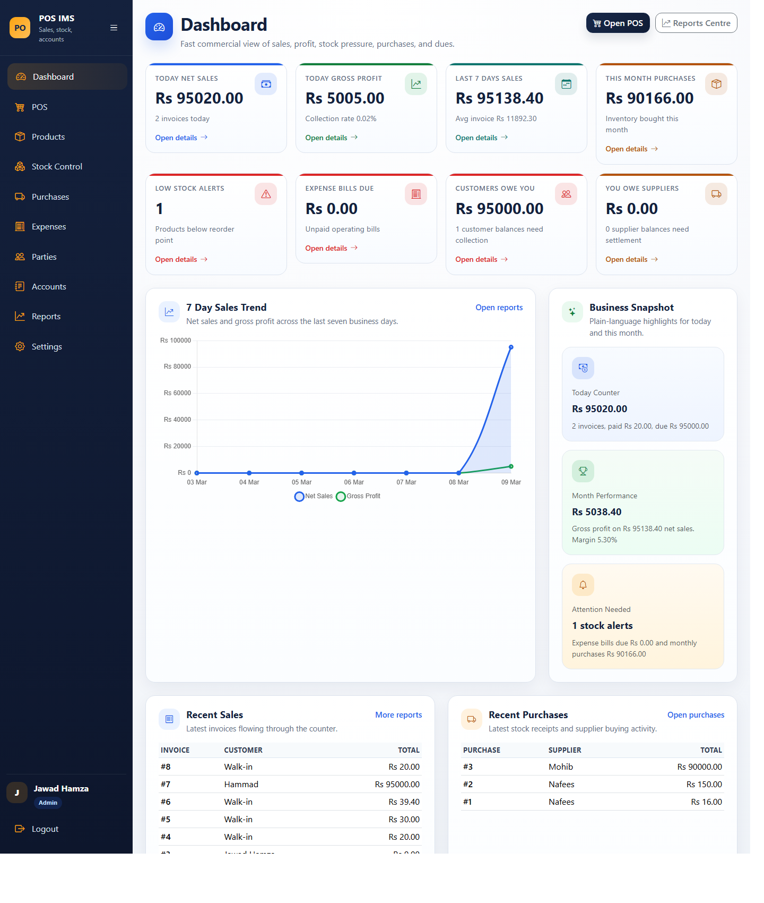

### POS checkout

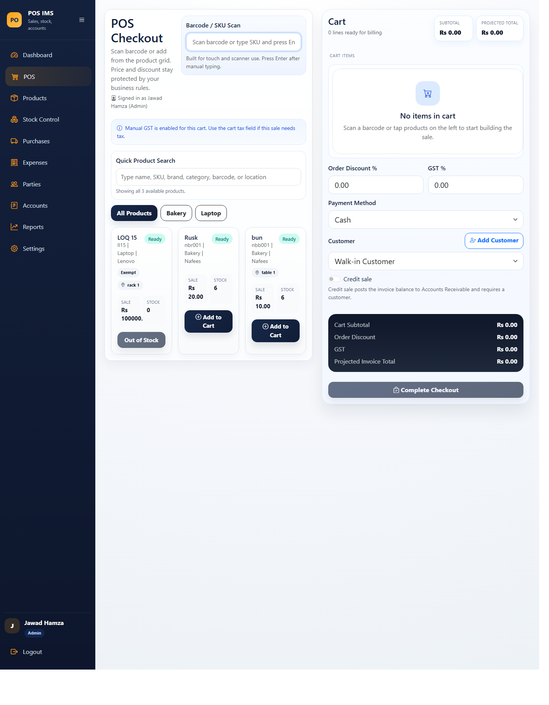

### Products

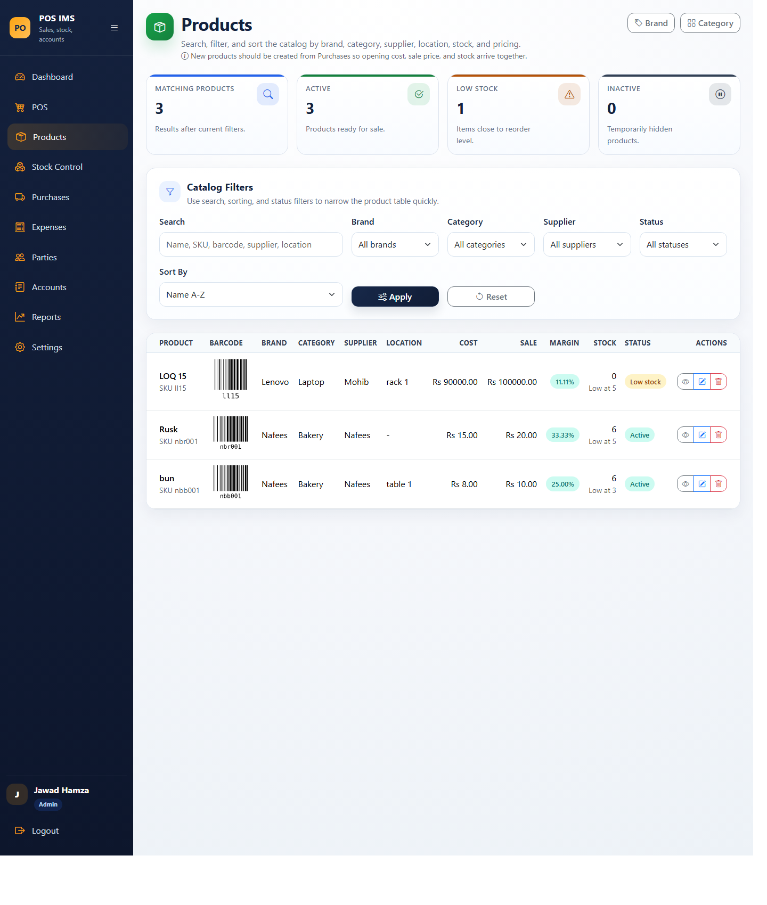

### Purchases

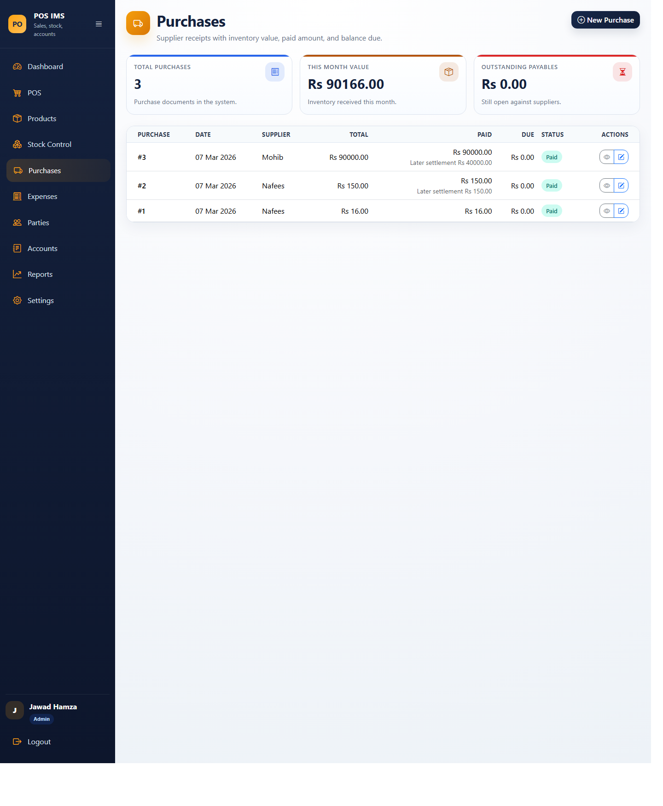

### Stock Control

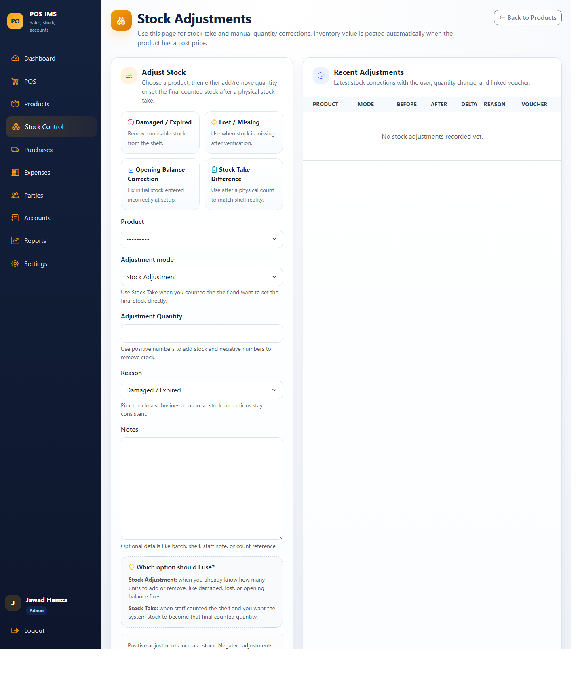

### Parties

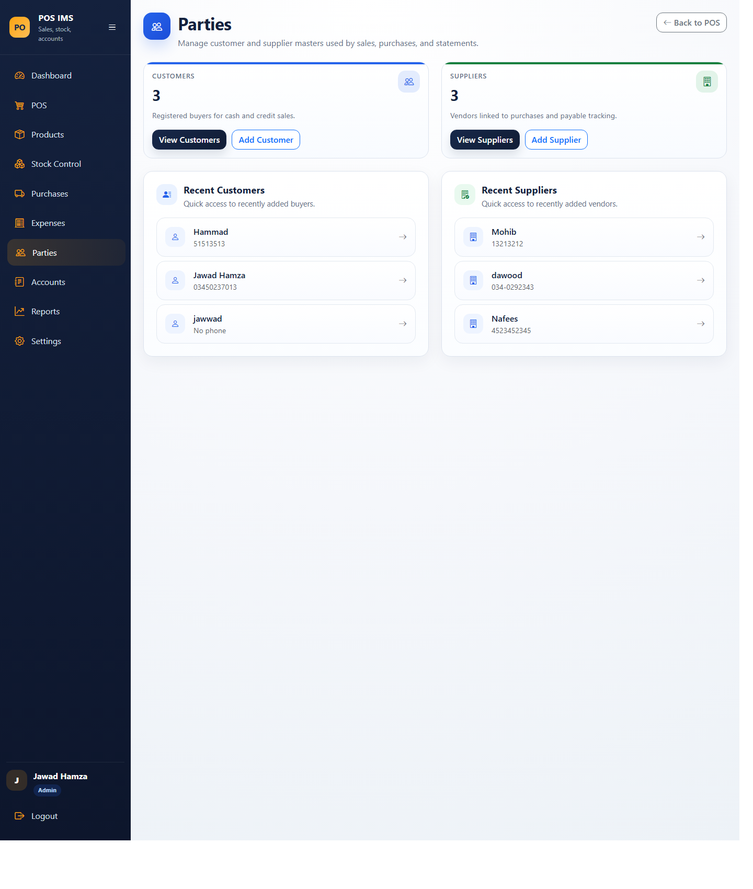

### Customers

### Suppliers

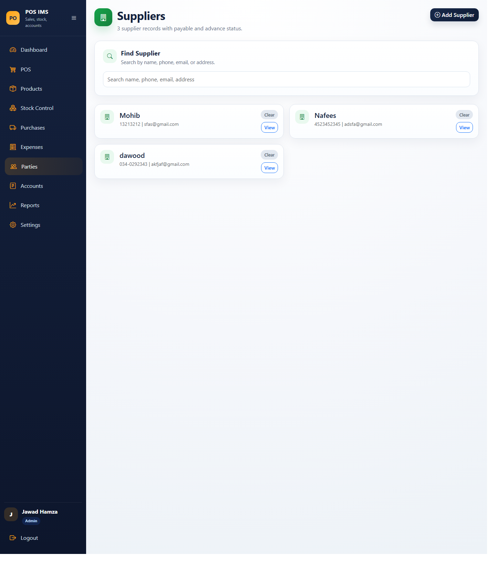

### Expenses

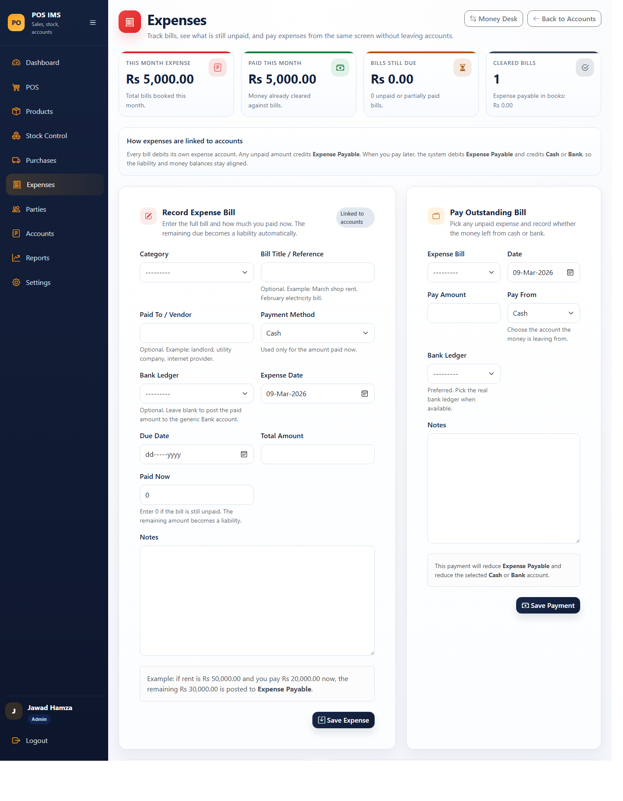

### Money Desk

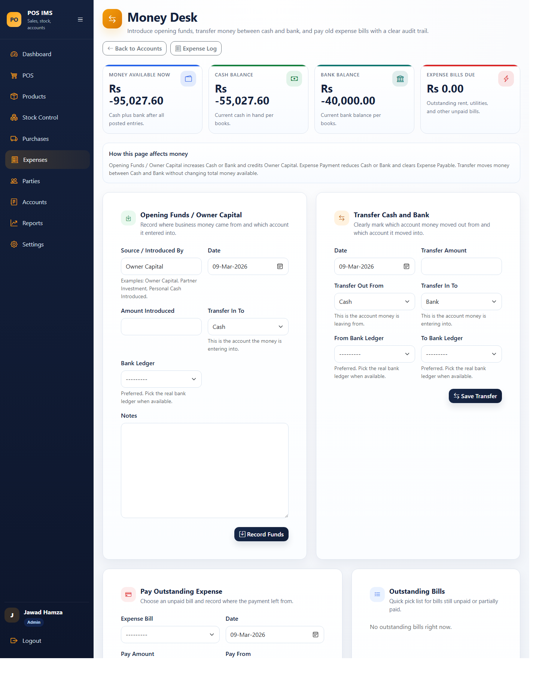

### Accounts

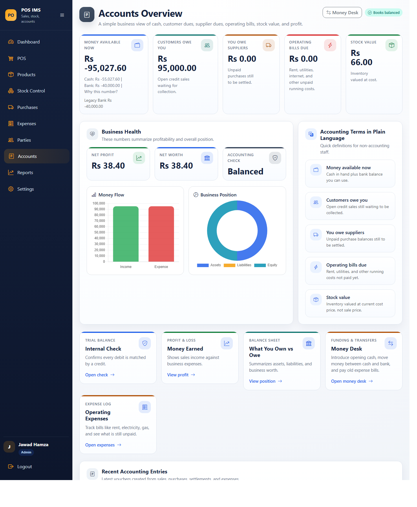

### Reports

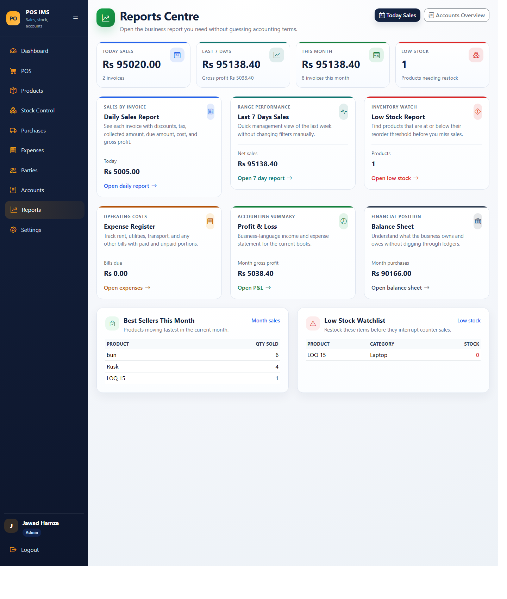

## 1. First-time setup

### Create the first admin

1. Open the app.
2. If no users exist yet, the system redirects to `setup/admin/`.
3. Create the first admin account.
4. Sign in using that account.

### Open Settings

Go to `Settings` and complete these areas:

- Business name, logo, address, phone, tax registration number, and invoice footer
- GST enabled or disabled
- Tax mode:
  - manual cart tax
  - category GST
- Tax label such as GST or VAT
- Allow or block credit sale
- Allow or block price override
- Allow or block line discount
- Default sale payment method
- Thermal printer width
- Team users and cashier logins
- Bank ledgers

## 2. Build the catalog the practical way

The recommended way to create real saleable items is through the `Purchases` workflow.

Why:

- the product can be created at the same time as the purchase
- cost price is captured correctly
- received quantity is entered immediately
- sale price and margin rules are set in context

You can still manage products later from `Products`, but purchases are the operational entry point for most new stock.

## 3. Make a purchase

Go to `Purchases` and create a new purchase.

What to do:

1. Choose the supplier if one exists.
2. If a supplier, brand, category, or product is missing, create it from the quick setup area.
3. Add one or more purchase lines.
4. Enter:
   - product
   - quantity received
   - unit cost
   - sale price to activate in POS
5. Enter the amount paid now.
6. Save the purchase.

What happens behind the scenes:

- stock goes up
- inventory value is posted into accounts
- the paid amount reduces Cash or Bank
- any unpaid balance becomes Accounts Payable against the supplier

## 4. Sell from POS

Go to `POS`.

### Add items

You can add items by:

- scanning barcode
- typing SKU into the scan field and pressing Enter
- tapping `Add to Cart` on a product card
- using the quick product search, which filters while you type

### Work with the cart

The cart allows:

- quantity increase or decrease
- line price edit if allowed in Settings
- line discount edit if allowed in Settings
- automatic validation against pricing rules

### Payment method

Choose:

- Cash
- Bank

If Bank is selected, you can choose a specific bank ledger or use the generic bank account.

### Customer and credit sale

- For walk-in sales, leave the customer empty.
- For credit sale, choose a customer and enable `Credit sale`.
- Credit sale requires a customer because the balance is posted to Accounts Receivable.

### Checkout

When you complete checkout:

- receipt is created
- stock is reduced
- accounting entries are posted
- cashier identity is saved on the sale

## 5. Understand tax handling

Tax behavior depends on Settings.

### Manual cart tax

Use this when a single cart-wide tax rate should be entered at sale time.

### Category GST

Use this when tax must follow product category rules.

When category GST is active:

- POS cart tax input is locked
- each category controls taxability and GST rate
- line tax is derived from product category

## 6. Manage customers and suppliers

Go to `Parties`.

### Customers

Use customer pages to:

- review purchase history
- check receivable balance
- record or inspect settlements
- filter statements by date

### Suppliers

Use supplier pages to:

- review purchase history
- check payable balance
- make supplier settlements
- filter statements by date

## 7. Record expenses

Go to `Expenses`.

Use this page for recurring and operating costs like:

- shop rent
- electricity
- gas
- internet
- transport
- repairs

Workflow:

1. Create an expense type if needed.
2. Record the expense.
3. Enter how much was paid now.
4. If something remains unpaid, it stays as `Expense Payable`.
5. Use `Pay Now` or `Money Desk` later to settle the due amount.

## 8. Use Money Desk

Go to `Accounts -> Money Desk`.

This page handles money movement outside normal sales and purchases.

### Owner capital / opening funds

Use this when the business receives starting money or owner investment.

### Cash and bank transfer

Use this when money moves between:

- Cash to Bank
- Bank to Cash
- one bank ledger to another bank ledger

### Pay old expense bill

Use this when an expense was recorded earlier but paid later.

## 9. Use Stock Control correctly

Stock Control is for correction, not normal buying or selling.

Normal stock movement should come from:

- purchase
- sale
- sale return
- purchase return

Use `Stock Control` only when physical stock and system stock do not match.

Examples:

- damaged items
- lost items
- opening balance correction
- stock take difference

Modes:

- `Stock Adjustment` - enter the increase or decrease
- `Stock Take` - enter the final counted quantity and let the system calculate the difference

## 10. Handle returns

### Sale return

Use invoice-based sale return so the system knows exactly which sale is being reversed.

### Purchase return

Use purchase-based return when items are sent back to the supplier.

Returns keep stock and accounting aligned.

## 11. Understand key dashboards

### Main dashboard

Shows operational KPIs such as:

- today's net sales
- today's gross profit
- money available now
- stock value
- customer balances due
- supplier balances due

### Accounts dashboard

Shows accounting KPIs such as:

- cash and bank balance
- receivables and payables
- expense payable
- inventory balance
- net profit
- net worth

### Money breakdown

Explains `Money Available Now` by showing cash and bank movement history.

## 12. Backups and audit trail

Use `Settings` to:

- create backup snapshots
- restore backups
- review recent audit activity
- review recent user sessions

## 13. Cashier use

Cashiers should:

- log in with their own username and password
- work only from POS
- keep customer attached to any credit sale
- avoid manual stock correction unless authorized

The system records login and logout times and stores which cashier made each sale.

## 14. Troubleshooting

### Stock looks wrong

Check:

- recent purchases
- recent sales
- sale returns
- purchase returns
- stock adjustment history

### Money available is negative

This usually means:

- purchases or expenses were paid
- but owner capital, opening money, or sales collections have not yet been fully recorded

### Credit sale not allowed

Check `Settings` and confirm `Allow credit sales` is enabled.

### Price edit or discount does not work

Check `Settings` and confirm price override or line discount is allowed for the business rules.

## 15. Recommended operating discipline

For clean books and fewer corrections:

1. Create stock through purchases, not manual stock edits.
2. Use Stock Control only for true corrections.
3. Attach the correct customer to every credit sale.
4. Attach the correct supplier to every unpaid purchase.
5. Record expenses as they happen.
6. Use Money Desk for capital and transfers.
7. Take backups before major changes or restores.
